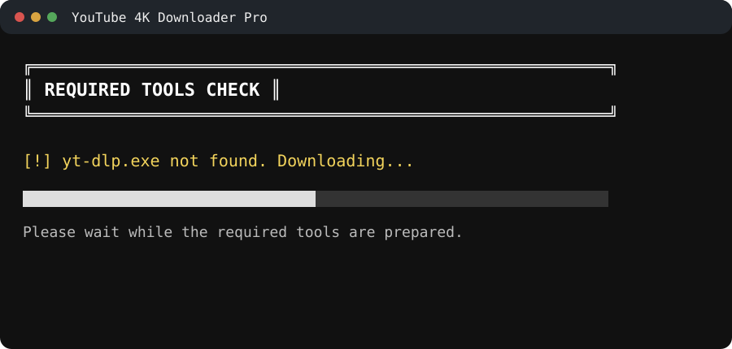
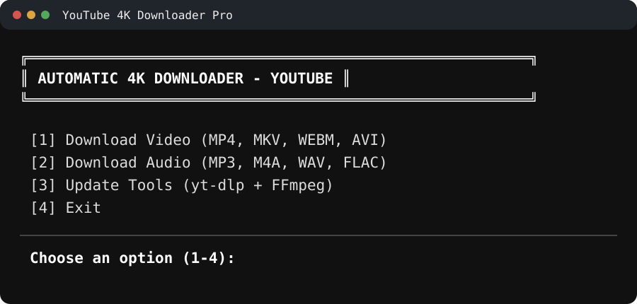
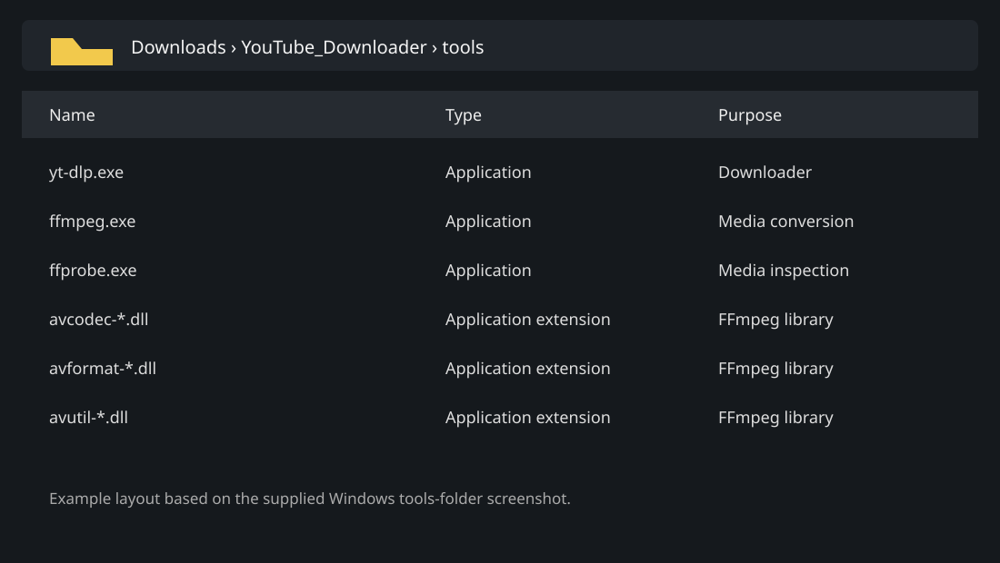

  

# 🎬 YouTube Downloader

I created YouTube Downloader as a Windows executable and distribute it through
the [Releases](../../releases) page.

YouTube Downloader is a menu-driven utility for downloading video and audio
from YouTube links. It uses `yt-dlp` for downloads and `FFmpeg` for media
processing and format conversion.

> ⚠️ **Disclaimer:** I provide this project **as-is**. I wrote the original
> code, but I am not responsible for account actions, copyright violations,
> data loss, damage, or any other consequence resulting from its use. Use it
> only for content you are legally allowed to download and at your own risk.

## ✅ Requirements

- 🪟 Windows
- 🔗 A YouTube video URL
- 📦 The `.exe` file downloaded from a release of this repository

The application checks for the required tools and downloads them when they are
missing. The `tools` directory may contain `yt-dlp`, `FFmpeg`, and their
supporting files after the first run.

## 📖 Tutorial

### 1️⃣ Download and open the program

1. Open the [latest release](../../releases/latest).
2. Download the `.exe` asset attached to the release.
3. Place it in its own folder, then run it.

🔒 Download executable files only from releases published in this repository.
Windows or antivirus software may show a warning for unsigned files, so review
the release information before deciding whether to continue.

### 2️⃣ Let the program install its tools

On the first launch, the program checks whether `yt-dlp` is available. If it
is missing, it downloads the required tool and displays the progress in the
console.

Wait until the check finishes before choosing an operation. Do not close the
window while a tool is being downloaded.

### 3️⃣ Choose video, audio, update, or exit

After the tools check, the main menu is displayed:

- **Download Video** — paste a YouTube URL and save video as MP4, MKV, WEBM,
  or AVI when those formats are available.
- **Download Audio** — paste a YouTube URL and extract audio as MP3, M4A, WAV,
  or FLAC when those formats are available.
- **Update Tools** — update `yt-dlp` and the media-processing tools.
- **Exit** — close the application.

Select an option by typing its number and pressing **Enter**.

### 4️⃣ Paste the YouTube link

When prompted, copy the URL from your browser, paste it into the console, and
press **Enter**. Follow the progress shown by the downloader and wait for the
operation to finish before closing the window.

Only download videos or audio that you own, have permission to use, or are
otherwise legally allowed to save. Respect YouTube's terms and the copyright
of the content creator.

### 5️⃣ Check the tools folder

The application keeps its supporting files in a `tools` folder next to the
executable. Depending on the release, this can include `yt-dlp`, `ffmpeg`,
`ffprobe`, and the FFmpeg libraries:

Do not delete or rename these files while the application is running. Use the
**Update Tools** option when the release provides it.

## 🧰 Tools

This project relies on third-party tools maintained by their respective
authors:

- [yt-dlp](https://github.com/yt-dlp/yt-dlp) for retrieving media
- [FFmpeg](https://ffmpeg.org/) for processing and converting media

Their licenses and terms remain applicable to the files distributed with the
application.

## 📦 Releases

I distribute executable files only through GitHub Releases. I do not commit
prebuilt binaries or downloaded third-party tools to the main branch.

## 🚫 No modification or support promise

I publish the source code and release files for this project only. Please do
not modify, repackage, redistribute, or claim authorship of them. I do not
provide a warranty, maintenance commitment, or support promise.

## 📄 License

All rights reserved. See [LICENSE](LICENSE).
